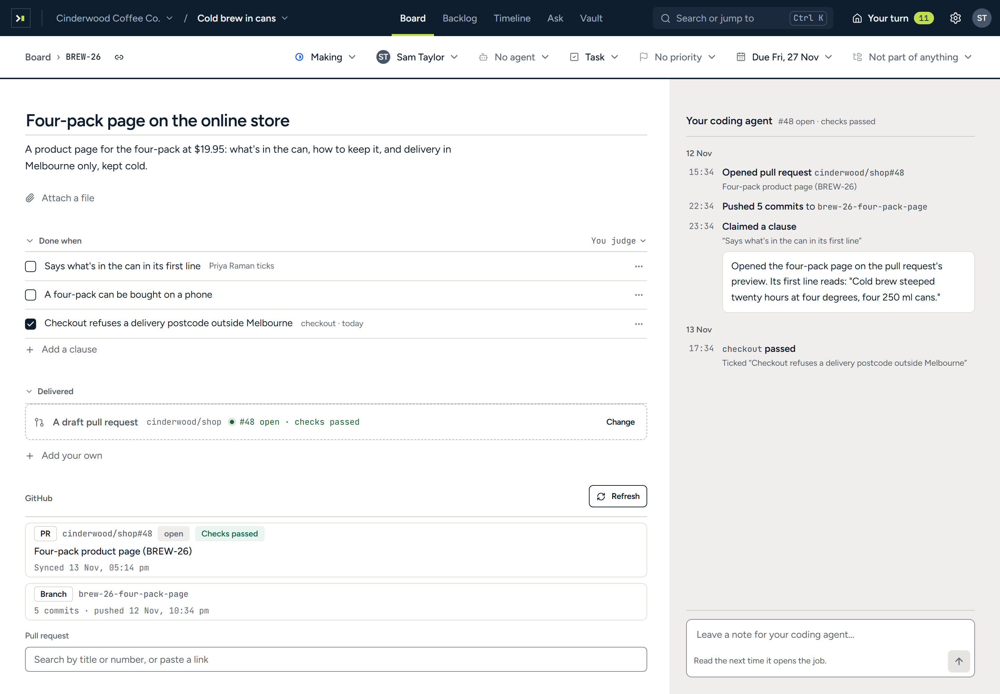

# Arbituro for coding agents

[Arbituro](https://arbituro.com) is work management where every job says what finished means. This
repository connects your coding agent to it: the MCP server's address, a plugin for each major
harness, and four skills that teach an agent to work a job the way its done-when asks.

Your coding agent does the work and asks. The decision stays with a person.



## What your agent can do

- **Read the contract before writing.** `get_job` gives the job in full: the description, the plan a
  person approved, and every done-when clause with who or what decides it.
- **Work where the job says.** The job names a branch. Commits that carry the job's key appear on the
  job as they are pushed, and the pull request links itself.
- **Let CI decide what CI can.** A clause "decided by the `test` check" is ticked by that check on the
  linked pull request, and by nothing else.
- **Ask a person for the rest.** `claim_done` records what the agent checked against a clause, and
  the person who decides it is asked in one press.
- **File a document.** Where a job asks for a document, a memo or a slide deck, `file_result` files
  it as Markdown.
- **Leave a trail.** Notes, proposals and new jobs are written under your name, and every call is on
  the record.

It cannot tick a clause, change one, finish a job, approve, merge, send, spend or delete. There is no
tool for any of those. The full list is in [docs/tools.md](docs/tools.md).

## Install

You need an Arbituro workspace: [sign up at app.arbituro.com](https://app.arbituro.com). There is no
key to make. Your agent opens a browser, you sign in, and it acts as you.

The server's address is `https://app.arbituro.com/mcp`.

### Claude Code

```bash
claude plugin marketplace add writan-labs/arbituro-mcp
```

```bash
claude plugin install arbituro@writan-labs
```

The plugin adds the server and the skills. For the server alone:

```bash
claude mcp add --transport http arbituro https://app.arbituro.com/mcp
```

### Codex

```bash
codex mcp add arbituro --url https://app.arbituro.com/mcp
```

```bash
codex mcp login arbituro
```

For the plugin, add this repository as a marketplace and install **Arbituro** from the Plugins
directory:

```bash
codex plugin marketplace add writan-labs/arbituro-mcp
```

### Gemini CLI

```bash
gemini extensions install https://github.com/writan-labs/arbituro-mcp
```

### Cursor

Add the server to `~/.cursor/mcp.json`, or to `.cursor/mcp.json` in a project:

```json
{
  "mcpServers": {
    "arbituro": { "url": "https://app.arbituro.com/mcp" }
  }
}
```

This repository is also a Cursor plugin (`.cursor-plugin/plugin.json`), carrying the server and the
skills together.

### VS Code and GitHub Copilot

Add the server to `.vscode/mcp.json`:

```json
{
  "servers": {
    "arbituro": { "type": "http", "url": "https://app.arbituro.com/mcp" }
  }
}
```

### Everything else

Any client that speaks MCP over streamable HTTP with OAuth can connect to
`https://app.arbituro.com/mcp`. [docs/install.md](docs/install.md) has the configuration for
Windsurf, OpenCode and others.

### The skills, in any harness

The skills are plain [Agent Skills](https://agentskills.io) and install into Claude Code, Codex,
Cursor, GitHub Copilot, Gemini CLI, OpenCode and the rest with one command:

```bash
npx skills add writan-labs/arbituro-mcp
```

## The skills

| Skill | Use it to |
| --- | --- |
| [`arbituro-work-job`](skills/arbituro-work-job/SKILL.md) | Work one job to its done-when: read it, branch, commit with its key, link the pull request, claim what you checked, leave a note. |
| [`arbituro-catch-up`](skills/arbituro-catch-up/SKILL.md) | See what is yours, what waits on you, and what happened in a project since you last looked. |
| [`arbituro-file-job`](skills/arbituro-file-job/SKILL.md) | File work you found as a new job, after checking nobody already has. |
| [`arbituro-file-result`](skills/arbituro-file-result/SKILL.md) | Write and file the document, memo or slide deck a job asks for. |

Then say it the way the job page does:

```text
Work ARB-12 in Arbituro.
```

## One workspace, or all of yours

`https://app.arbituro.com/mcp` reaches every workspace you are in, and the project you name chooses
the workspace. To give an agent one workspace and no other, connect that workspace's own address
instead, which **Settings → Keys and coding agent** shows:

```text
https://app.arbituro.com/mcp/<workspace>
```

Somebody in two clients' workspaces should connect each one separately, so what one client wrote
never steers an agent working in the other's.

## How sign-in works

- **OAuth, in your browser.** Your agent discovers the authorization server from the address, sends
  you to sign in, and keeps the token it is given. Arbituro has no personal access tokens for MCP.
- **The agent is you.** Everything it writes is under your name, and it can open only the projects
  you can.
- **A token opens one door.** A token for one address is refused at every other, and at the web
  app's own API.
- **Every call is recorded**, reads included, naming the client that made it.

More in [docs/security.md](docs/security.md). To report a vulnerability, see [SECURITY.md](SECURITY.md).

## For programs

The same operations are a JSON API at `https://app.arbituro.com/api/v1`, described by one OpenAPI
document at [`/api/v1/openapi.json`](https://app.arbituro.com/api/v1/openapi.json). It takes an API
key made in your settings, for one workspace.

## What is in this repository

| Path | What it is |
| --- | --- |
| `server.json` | The server's entry for the [MCP Registry](https://registry.modelcontextprotocol.io) |
| `skills/` | The four skills, shared by every plugin below |
| `.claude-plugin/` | The Claude Code plugin and its marketplace |
| `.codex-plugin/`, `.agents/plugins/` | The Codex plugin and its marketplace |
| `.cursor-plugin/` | The Cursor plugin |
| `gemini-extension.json`, `GEMINI.md` | The Gemini CLI extension |
| `mcp/` | The server's configuration in each harness's own format |
| `snippets/AGENTS.md` | A paragraph for your own repository's `AGENTS.md` |
| `docs/` | The tools, the install steps for every client, and how access works |

The server itself is hosted by Arbituro and is not in this repository.

## Licence

[MIT](LICENSE). Arbituro is made by Writan Labs.
